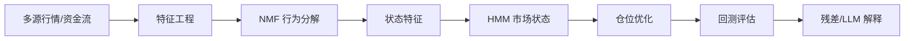

# 架构说明

## 数据流

## 模块职责

| 模块 | 职责 |
|------|------|
| `采集/` | 拉取、缓存、行业映射 |
| `分析/特征/` | 分钟/日频特征矩阵 |
| `分析/推断/` | NMF、HMM、状态分类、残差检测 |
| `分析/回测/` | 状态驱动回测与仓位映射优化 |
| `分析/批处理/` | 批量跑批、全市场增量分析 |
| `接口/` | Web API 数据聚合、组合推荐 |
| `分析/仿真/` | 五智能体订单簿仿真（可选） |

## 目录约定

- **代码索引**：`symbol.txt` 记录真实 6 位代码
- **路径索引**：`data_index.csv` / `stocks_index.csv` 记录 `path` 字段
- **行业来源**：优先东方财富，失败时回退 baostock 证监会行业并映射申万一级

## 扩展点

- 新增数据源：在 `采集/数据源.py` 注册 `FetchFn`
- 新增状态方法：在配置 `state.method` 切换 `hmm` / `rule`
- 新增批量标的：编辑 `后端/配置/配置档/*.yaml` 的 `batch.symbols`
